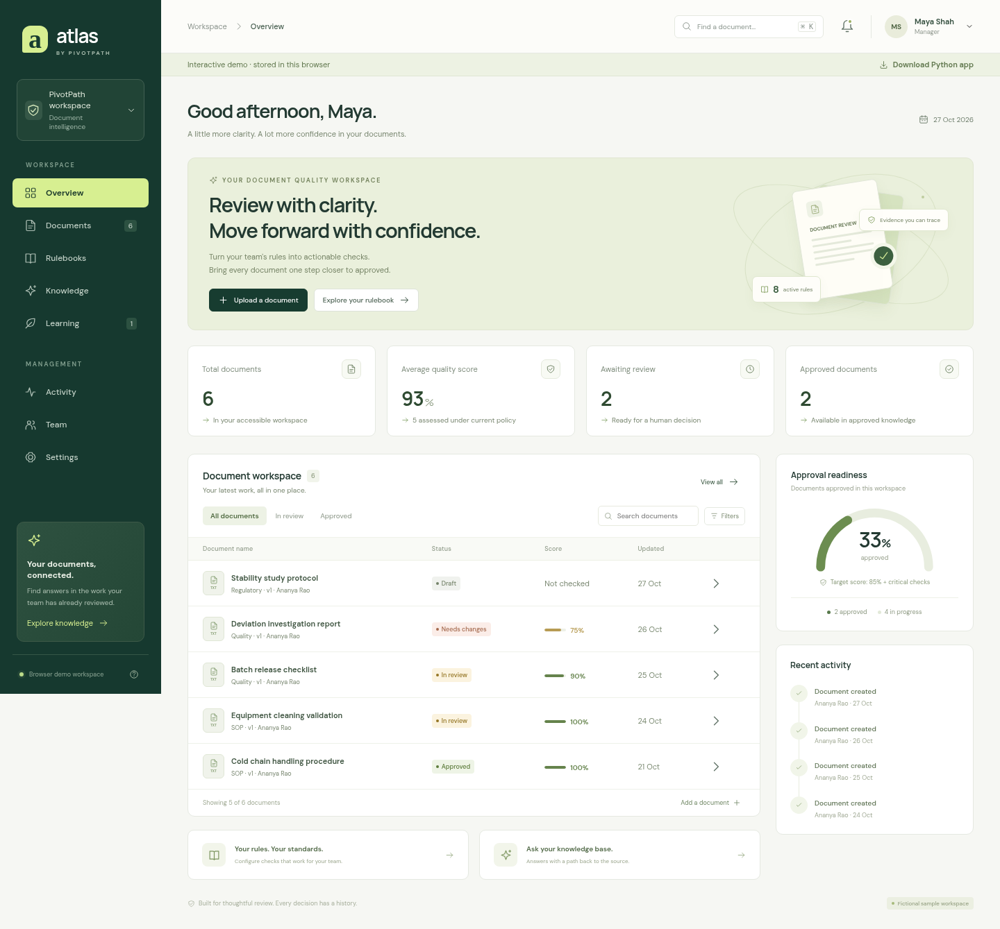

# PivotPath Atlas

**Turn rules into evidence, corrections into versions, and approved work into searchable knowledge.**

Atlas is a Python document review application built for a practical internal demonstration at PivotPath. Upload a document, check it against a configurable rulebook, correct the extracted text, and send a version for independent approval. Ask questions across documents you are allowed to access, with links back to the evidence.



## Start here

1. Install [Python 3.11 or newer](https://www.python.org/downloads/). On Windows, select **Add Python to PATH** during installation.
2. Download the [Atlas implementation branch](https://github.com/kaushik6994/Pivotpath_Ai/tree/codex/atlas-document-workspace) as a ZIP and extract it, or clone that branch.
3. On Windows, double-click **scripts → start.bat**. On macOS or Linux, open a terminal in the project folder and run `bash scripts/start.sh`.
4. Your browser opens [Atlas](http://127.0.0.1:8000). The first launch installs dependencies and takes longer. Keep the terminal open while using the app.

The demonstration includes fictional documents and four switchable personas. You do not need an API key, an external AI subscription, Node.js, or a database server.

**New to VS Code?** Follow the [setup guide](docs/SETUP.md) for Windows, macOS, Linux, troubleshooting, and GitHub instructions.

## What you can demonstrate

- **Four roles:** authors prepare documents, reviewers make independent decisions, managers own policy, and administrators manage users.
- **Configurable rulebooks:** required text, prohibited text, minimum word counts, and required sections; each with category, weight, severity, and an explanation.
- **Transparent scoring:** weighted pass scores, an editable threshold, and blocking critical findings. Changing policy requires a fresh analysis before approval.
- **Document workspace:** PDF, DOCX, TXT, and Markdown ingestion; editable extracted text; saved versions; PDF and text export; preserved original uploads.
- **Review workflow:** draft, in review, needs changes, and approved states, with server-enforced access and no self-approval.
- **Evidence search:** permission-filtered lexical retrieval over approved documents by default, with document/version citations. Explicitly include accessible drafts when needed.
- **Reviewed learning:** collect correction feedback, approve useful examples, and reuse them as suggestions. Feedback never silently rewrites a rule.
- **Audit history:** document actions, reviews, policy changes, and access administration recorded in the local database.

## A five-minute manager demo

Use the [demo script](docs/DEMO_SCRIPT.md): open the dashboard, upload `examples/training-sop-draft.md`, explain a failed finding, save a correction, recheck, switch to a reviewer, and search the approved result. Show the manager changing a threshold and the learning queue requiring approval.

## Run manually

```bash
python -m venv .venv
# Windows: .venv\Scripts\activate
# macOS/Linux: source .venv/bin/activate
python -m pip install -r requirements.txt
python -m uvicorn backend.app:app --host 127.0.0.1 --port 8000
```

Run tests with `python -m pytest`. API documentation is available at [localhost:8000/docs](http://127.0.0.1:8000/docs) while the server is running.

## Architecture and boundaries

FastAPI serves the browser UI and API from one origin. SQLite stores users, document versions, policies, review decisions, and feedback. The rule engine is deterministic; the knowledge component returns grounded, extractive results from retrieved text. This version does not train a language model or require a vector database.

Edited PDF exports are newly typeset from the corrected text; original page layouts, graphics, forms, and signatures are not preserved in those exports. Image-only/scanned PDFs need OCR before upload. Supported formats are deliberately explicit rather than claiming to process every file type.

This is a working prototype for document review, not a validated pharmaceutical quality system or a regulatory certification tool. Rules identify text conditions; they do not establish scientific correctness. See [architecture, security, and deployment considerations](docs/ARCHITECTURE.md) before handling real company documents or deploying beyond your computer.

## Project map

```text
backend/       Python API, persistence, rule engine, retrieval, file handling
web/           Browser interface; no frontend build step
tests/         Rule-engine and API verification
examples/      Fictional documents for a repeatable demonstration
scripts/       First-run installer and local launchers
docs/          Setup, product brief, architecture, demo, API contract
.vscode/       Recommended extensions and Python debug configuration
```

The [product brief](docs/PRODUCT_BRIEF.md) explains the personas and acceptance criteria. The [architecture guide](docs/ARCHITECTURE.md) includes the retrieval flow, access model, and a roadmap for an organization-managed deployment.
