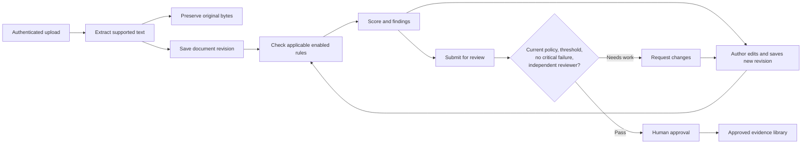
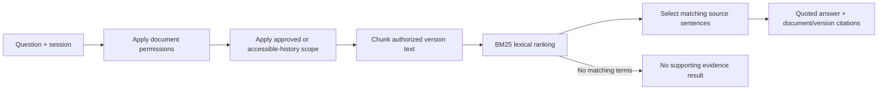
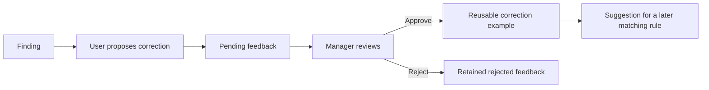

# Atlas architecture

Atlas is a single-workspace Python application. FastAPI serves both the API and a buildless browser interface, so the local app needs one process and one origin. SQLite persists the workspace; no external AI service is required.

## Components

| Component | Responsibility |
| --- | --- |
| `web/` | Responsive workspace, document editor, rule forms, review actions, evidence search, and administration |
| `backend/app.py` | Validated API inputs, session authentication, access checks, workflow decisions, and audit events |
| `backend/db.py` | SQLite schema, transactions, workspace mode, and storage configuration |
| `backend/engine.py` | Deterministic rule evaluation and weighted eligibility |
| `backend/document_io.py` | PDF/DOCX/TXT/MD extraction and newly typeset PDF exports |
| `backend/knowledge.py` | Chunking, lexical BM25 retrieval, and extractive answers with citations |
| `backend/auth.py` | Scrypt password hashes and opaque, server-side sessions |
| `backend/seed.py` | Fictional demo records or fresh-workspace administrator bootstrap |

The browser sends requests to `/api`. The same Python process serves `web/` after API routes. API errors use a readable `detail` message. Interactive API documentation is at `/docs` while the server is running.

## Document and review flow

The score is `100 × passed rule weight / total applicable rule weight`. Category-specific rules apply alongside `All` rules. Disabled rules are excluded. An empty applicable rulebook is never eligible for approval. A critical failure blocks approval even if the weighted score meets the threshold. Scores measure the configured text conditions, not scientific correctness.

Saving changed content or a changed title creates a new revision, clears the current report, and returns the document to draft. Previous revision content is retained. Running analysis updates the current revision's assessment; content history and an assessment history are different concepts. Audit events record analysis actions, but this prototype does not store every assessment as an immutable, separately signed record.

Rule changes and threshold changes advance `policy_version`, clear current assessments, and return previously approved documents to review. They therefore leave the default approved search collection until rechecked and approved again. Changing retrieval limits or enabling/disabling correction reuse does not change the scoring policy.

## Retrieval-augmented answers

This is an **extractive RAG baseline**: retrieval supplies the passages used in the answer, and the answer quotes those passages instead of asking a language model to invent prose. It is not semantic embedding search. Questions using the document's own terms work best; synonyms, cross-document reasoning, and ambiguous questions can need a more capable retriever or human interpretation. Relevance scores are ranking signals, not confidence percentages.

Permissions are applied **before** chunking and ranking. Approved scope searches current approved versions. The expanded scope can search accessible drafts and retained revisions; it does not grant new access. Citations identify the source document and saved version, and include a page where extracted PDF page boundaries are available. A citation to an older revision is historical evidence, not proof that its instruction remains current.

Chunks are built at query time, approximately 180 words with a 35-word overlap. This keeps the small local demonstration simple and avoids stale index entries. Larger collections would need a persistent index, incremental updates, and bounded background jobs.

If an external generator is added later, keep access filtering before retrieval, send only authorized passages, treat document text as data, require citations, and evaluate unsupported answers. The current application makes no outbound model calls and has no hidden dependency on a paid AI account.

## Reviewed learning

Learning means approved correction memory, not model training. Approved examples can replace a rule's suggested correction text when findings are displayed to an authorized reader. Stored reports retain the base guidance, preventing a private correction from being copied into a shared report. They do not change the rule, its weight, the pass/fail result, or the approval threshold. Disabling learning pauses collection and reuse. Examples remain associated with their source document and must obey its access boundary. Reviewers still decide whether a suggestion is accurate for the document being edited.

## Roles and access

| Action | Author | Reviewer | Manager | Administrator |
| --- | --- | --- | --- | --- |
| Create documents | Yes | Yes | Yes | Yes |
| Read documents | Own + current approved team documents | Own + team + assigned | All in workspace | All in workspace |
| Edit documents | Own draft / needs changes | Accessible unapproved documents | All | All |
| Approve / request changes | No | Accessible submitted documents | Submitted documents | Submitted documents |
| Approve own document | No | No | No | No |
| Manage rules and settings | No | No | Yes | Yes |
| Propose correction feedback | Accessible documents | Accessible documents | Yes | Yes |
| Review feedback | No | No | Yes | Yes |
| Create / deactivate users and change roles | No | No | No | Yes |

“Private” means limited within this workspace, not hidden from managers or administrators. An assigned reviewer can access a private document. Downloads, original uploads, history, feedback, and search require the same relevant authorization. Authors reading somebody else's approved document receive the approved current content rather than access to its previous drafts.

The API enforces permissions independently of the buttons shown in the interface. Login creates a random session token; the server stores its hash, while the browser receives an HttpOnly, SameSite cookie. Sessions expire after 12 hours. Deactivating a user removes their sessions. Mutating API requests reject cross-site origins. Passwords use salted scrypt hashes.

## Storage and exports

By default, `data/atlas.sqlite3` contains users, sessions, documents, original file bytes, revision text, rules, settings, feedback, and audit rows. Change `ATLAS_DATA_DIR` or `ATLAS_DB_PATH` to choose another location. Local database files are not encrypted by the application; operating-system account security and disk encryption matter.

Uploads are limited to 10 MB and extracted text to 500,000 characters. Supported formats are PDF, DOCX, UTF-8 TXT, and Markdown. Scanned/image-only PDFs require OCR outside Atlas. Encrypted, malformed, unsupported, or oversized files receive a useful error.

Edited PDF exports are newly typeset from saved text. They do not preserve the source PDF's exact page layout, images, forms, annotations, or signatures. The original file remains separately downloadable where permitted. Exported text is escaped before formatting, and a bundled font supports common Unicode characters; it does not guarantee every writing system or complex shaping.

For a local backup, stop the server and copy the configured data directory to an approved secure location. Do not commit databases or real documents to Git. A shared deployment needs tested backups and restoration procedures instead of relying on a developer's laptop.

## Local Python app versus hosted demo

The complete Python app uses the authenticated API and persistent SQLite database. Its demo mode seeds fictional users and allows one-click persona switching. A separate non-demo database uses real credentials and disables that shortcut.

The optional hosted demonstration uses `web/demo.js` and browser storage, explicitly enabled by its build configuration. It is a UI demonstration, not an authenticated shared backend: switching demo roles is illustrative, data stays in that browser, and clearing site data removes it. It accepts TXT/MD input; PDF and DOCX extraction belong to the Python app. The real API client never silently falls back to that demo when the server is unavailable.

## Before a real company deployment

This is a working prototype, not a validated pharmaceutical quality system. Before adopting it for operational decisions, the team should define its validation requirements and assess at least the following concrete gaps:

- Organization-managed sign-in, password recovery, account provisioning, and team or project boundaries. Current access is one workspace, with all-document manager access.
- A supported Python host with HTTPS, secure cookies, persistent storage, secret management, monitoring, backups, and a restore drill. GitHub alone does not run the backend.
- Upload malware scanning, OCR, large-document background processing, quotas, and load testing. SQLite and per-request lexical indexing target a small demonstration workload.
- Durable assessment snapshots, document signatures, tamper-evident audit retention, retention/deletion policy, and any required electronic-signature controls. The current database administrator can modify local records.
- Reviewed pharmaceutical policies and evidence of accuracy. Literal phrase checks cannot validate whether a named owner, date, scientific statement, or acceptance criterion is correct.

Add semantic search or a generator based on measured retrieval failures, not to imply that the existing text checks establish regulatory compliance.
